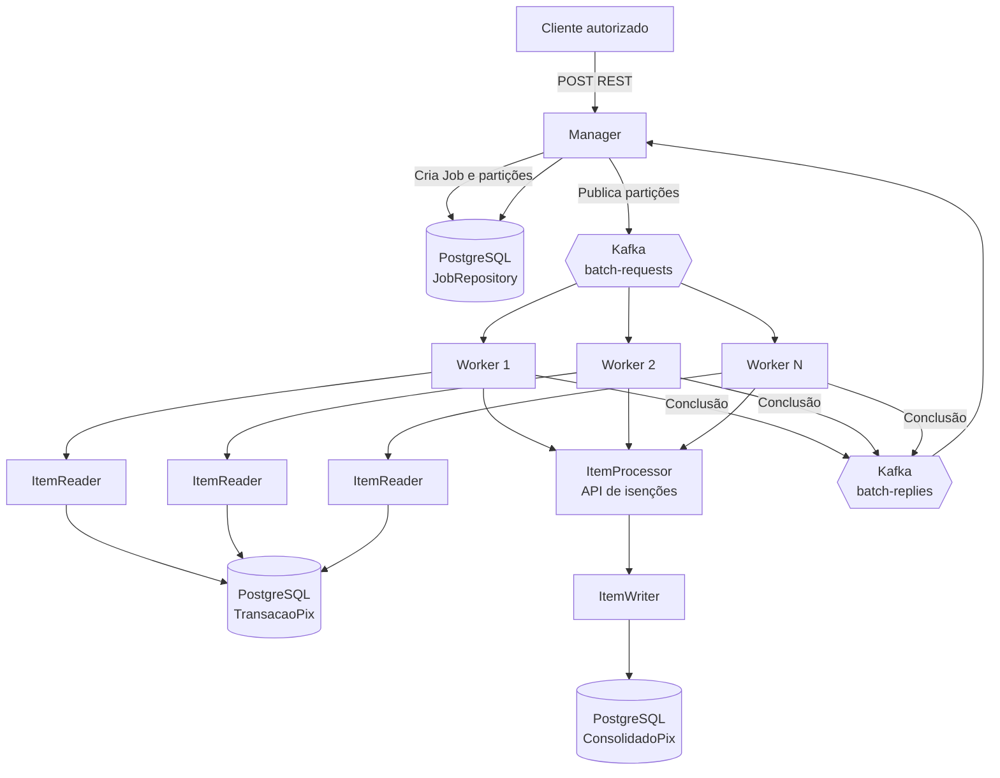

# Consolidação de Tarifas Pix

Microsserviço distribuído para consolidação de tarifas de transações Pix,
implementado com Java 21, Spring Boot 4.x, Spring Batch, Apache Kafka e
PostgreSQL.

As decisões arquiteturais canônicas estão em
`.github/copilot-instructions.md`. Os arquivos em `.github/instructions/`
detalham o contrato Pix e a observabilidade.

O processamento utiliza **Remote Partitioning** do Spring Batch. O trabalho é
orquestrado por um nó Manager e executado horizontalmente por múltiplos nós
Worker. Cada execução é iniciada exclusivamente por um endpoint REST protegido.

> **Status atual:** o endpoint REST, o `JobRepository`, as migrations, as
> entidades Pix, o Partitioner, o Job do Manager e o processamento inicial do
> Worker estão implementados. A integração dos canais internos com Kafka e a
> chamada real para a API de isenções permanecem como próximas etapas.

## Visão completa do projeto

O objetivo final é consolidar tarifas de um grande volume de transações Pix
com processamento distribuído. A aplicação será executada como um único
artefato, mas poderá assumir dois perfis lógicos:

- `manager`: recebe solicitações REST, cria e acompanha Jobs e distribui o
  trabalho;
- `worker`: consome partições Kafka e executa o processamento de negócio.

O Manager e os Workers compartilharão o PostgreSQL e o `JobRepository`. O
Kafka será utilizado exclusivamente para transportar metadados de instruções e
respostas do Remote Partitioning. A quantidade de Workers poderá crescer ou
diminuir sem alterar o contrato do Manager.

O fluxo completo planejado será:

```text
Cliente autorizado
    |
    | 1. POST /api/v1/batches/pix-consolidation/executions
    v
Manager - API REST
    |
    | 2. Valida a requisição e o partitionSize
    | 3. Cria os parâmetros da execução
    v
Spring Batch - JobRepository compartilhado
    |
    | 4. Registra JobExecution e StepExecution
    v
Manager - Partitioner
    |
    | 5. Consulta TransacaoPix pendentes
    | 6. Obtém minId e maxId
    | 7. Divide o intervalo em partições
    v
Kafka - batch-requests
    |
    | 8. Publica uma instrução por partição
    v
Workers escaláveis
    |
    | 9. Cada Worker recebe uma partição
    | 10. ItemReader lê o range minId/maxId
    | 11. ItemProcessor valida e consulta a API de isenções
    | 12. ItemProcessor calcula a tarifa
    | 13. ItemWriter persiste ConsolidadoPix
    | 14. Worker publica o resultado
    v
Kafka - batch-replies
    |
    | 15. Manager recebe a conclusão de cada partição
    | 16. Atualiza o estado do Step e do Job
    v
JobRepository
    |
    | 17. Job concluído, falho ou disponível para retomada
    v
Resposta e observabilidade
```

### Etapas detalhadas do processamento

#### 1. Solicitação de execução

Um cliente autorizado envia uma requisição ao endpoint REST do Manager,
informando o tamanho desejado das partições. O endpoint valida o payload,
autentica a chamada e delega a execução ao Spring Batch.

O endpoint não executa regras de tarifa, não processa registros Pix e não
publica mensagens manualmente. Sua responsabilidade é iniciar o fluxo
orquestrado pelo Job.

#### 2. Registro do Job

O Spring Batch cria uma execução no `JobRepository`, registrando os parâmetros,
o estado inicial e os identificadores técnicos do Job e do Step. Esses
identificadores acompanharão todas as mensagens Kafka para permitir rastreio,
retomada e diagnóstico.

Execuções equivalentes devem possuir parâmetros controlados para evitar que uma
nova chamada crie um Job duplicado indevidamente. A política de reexecução será
definida junto com a configuração do `JobRepository`.

#### 3. Consulta das transações pendentes

O Manager consulta a tabela `TransacaoPix` para identificar os registros
pendentes de consolidação. Ele calcula os limites do conjunto, como `minId` e
`maxId`, mas não aplica a regra de negócio da tarifa.

O Manager pode dividir, por exemplo, um milhão de registros em partições de
dez mil IDs. A estratégia deve respeitar o `partitionSize` recebido e evitar
partições vazias quando não existirem transações pendentes.

#### 4. Publicação das partições

Para cada partição, o Manager publica uma mensagem no tópico
`batch-requests`. A mensagem conterá:

- `jobExecutionId`;
- `stepExecutionId`;
- `partitionId`;
- `minId`;
- `maxId`;
- nenhum payload Pix.

O `partitionId` será a chave técnica da instrução Kafka. O Worker usará
`minId` e `maxId` para ler a fonte de verdade no PostgreSQL. Essa decisão evita
duplicidade de dados, mensagens grandes e exposição desnecessária de dados
pessoais.

#### 5. Consumo pelos Workers

Os Workers estarão inscritos no tópico `batch-requests` usando um grupo de
consumidores compatível com o processamento distribuído. O Kafka distribuirá
as partições entre as instâncias disponíveis.

Cada Worker receberá os metadados da partição e executará um Step Spring Batch
isolado. O Worker não dependerá de memória local para manter o estado da
execução; o estado transacional ficará no banco e os metadados da partição
serão transportados na mensagem.

#### 6. Leitura das transações

O `ItemReader` buscará somente as transações pertencentes ao intervalo
`minId`/`maxId` recebido. A leitura será feita em chunks para limitar o uso de
memória e permitir commits transacionais frequentes.

O Worker não recebe o payload Pix pelo Kafka. A consulta ao PostgreSQL deve
garantir que nenhum Worker processe registros fora da partição que recebeu.

#### 7. Processamento da tarifa

O `ItemProcessor` será o único componente responsável pela regra de negócio.
Para cada transação, ele deverá:

1. validar os campos necessários;
2. consultar a API externa simulada de isenções;
3. aplicar a política de tarifa;
4. calcular o valor usando `BigDecimal`;
5. produzir o resultado que será persistido.

A API externa poderá retornar se a conta é isenta, qual regra foi aplicada e
quais dados são necessários para o cálculo. Falhas transitórias deverão usar
retry; falhas permanentes deverão ser registradas explicitamente e seguir a
política de erro da partição.

#### 8. Persistência do consolidado

O `ItemWriter` salvará os resultados na tabela `ConsolidadoPix`, mantendo a
relação com a transação original. O `endToEndId` terá uma restrição única ou
índice equivalente.

Se uma partição for reprocessada, o Writer não poderá criar uma cobrança
duplicada. O comportamento para uma mesma transação com dados divergentes será
definido explicitamente, com rejeição ou atualização controlada conforme a
política do domínio.

A confirmação da mensagem Kafka somente poderá ocorrer depois que o
processamento da partição e sua persistência transacional forem concluídos com
sucesso.

#### 9. Retorno da conclusão

Após concluir a partição, o Worker publicará uma mensagem no tópico
`batch-replies`, contendo:

- identificadores do Job, Step e partição;
- status `SUCCESS` ou `FAILED`;
- quantidade lida, processada e rejeitada;
- mensagem técnica de erro, quando aplicável;
- informações necessárias para retomada.

O Worker deverá publicar o retorno tanto para conclusões bem-sucedidas quanto
para falhas tratadas. Dados pessoais e payloads Pix completos não devem ser
incluídos no retorno nem nos logs.

#### 10. Acompanhamento pelo Manager

O fluxo suportado de Remote Partitioning do Spring Batch consumirá
`batch-replies` e correlacionará cada resposta com o `jobExecutionId`,
`stepExecutionId` e `partitionId` registrados no `JobRepository`. Não alterar
manualmente as tabelas internas do repositório.

O Job será concluído com sucesso somente quando todas as partições esperadas
forem concluídas. Se uma partição falhar, o Manager deverá manter o erro
explícito, impedir uma conclusão falsa e disponibilizar a execução para retry
ou retomada conforme a política do Spring Batch.

## Fluxos de falha e retomada

### Falha antes da publicação

Se o Manager falhar antes de publicar todas as partições, o `JobRepository`
manterá o estado da execução. Uma retomada deverá publicar somente as partições
pendentes, sem duplicar aquelas já confirmadas.

### Falha durante o consumo Kafka

Se o Worker falhar antes de persistir o chunk, a mensagem não deverá ser
confirmada como concluída. O Kafka poderá entregá-la novamente e o Spring Batch
deverá retomar a partir do estado persistido.

### Falha durante a API de isenções

Falhas transitórias deverão ser submetidas a retry limitado. Após o limite, a
partição deverá ser marcada como falha ou a mensagem deverá seguir para o
Dead Letter Topic, conforme o tipo do erro.

### Mensagem inválida

Mensagens malformadas, com campos obrigatórios ausentes ou com valores
incompatíveis deverão ser rejeitadas explicitamente. Elas não poderão ser
confirmadas silenciosamente como processadas. O erro deverá ser direcionado ao
mecanismo de retry e DLT.

### Reprocessamento

No reprocessamento, `endToEndId`, estado do consolidado e restrições de banco
serão usados para garantir idempotência. O resultado final não poderá gerar
duplicidade mesmo que a mesma partição seja entregue mais de uma vez.

## Perfis de execução planejados

O mesmo artefato poderá ser executado com perfis Spring distintos:

```text
manager
  - endpoint REST protegido
  - JobLauncher
  - Partitioner
  - publicação em batch-requests
  - listener de batch-replies

worker
  - consumidor de batch-requests
  - Step orientado a chunks
  - ItemReader
  - ItemProcessor
  - ItemWriter
  - publicação em batch-replies
```

Os perfis não deverão introduzir lógica de agendamento. Toda execução deverá
começar pelo endpoint REST do Manager.

## Resultado esperado

Quando todas as etapas estiverem implementadas, uma chamada REST deverá ser
capaz de iniciar uma execução distribuída que:

1. registre o Job no banco;
2. encontre as transações Pix pendentes;
3. distribua as partições pelo Kafka;
4. processe as partições em múltiplos Workers;
5. consulte a API externa de isenções;
6. calcule e persista as tarifas;
7. evite duplicidades no reprocessamento;
8. acompanhe as conclusões no Manager;
9. permita retomada após falhas;
10. exponha métricas de desempenho e negócio.

Esse é o fluxo arquitetural alvo. As funcionalidades ainda não implementadas
serão adicionadas gradualmente, seguindo a ordem descrita na seção
[Ordem de implementação](#estrutura-esperada).

## Objetivos

- Processar grandes volumes de transações Pix em paralelo.
- Distribuir partições por meio do Kafka.
- Separar a orquestração do processamento de negócio.
- Permitir escala horizontal dos Workers.
- Garantir retomada e reprocessamento seguro de partições.
- Evitar duplicidade por meio do `endToEndId`.
- Expor métricas técnicas e de negócio para Prometheus e Grafana.

## Arquitetura

O projeto possui dois perfis lógicos da mesma aplicação:

### Manager

O Manager é responsável exclusivamente pela orquestração:

- receber uma solicitação autenticada via REST;
- criar os parâmetros do Job;
- consultar as transações Pix pendentes;
- obter os limites `minId` e `maxId`;
- dividir o trabalho em partições;
- publicar instruções no tópico `batch-requests`;
- acompanhar as respostas no tópico `batch-replies`;
- atualizar o estado no `JobRepository`.

O Manager **não executa regras de negócio**, não calcula tarifas e não processa
diretamente as entidades Pix.

### Worker

Cada Worker consome uma partição do tópico `batch-requests` e executa o Step
Spring Batch:

1. `ItemReader` lê as transações do intervalo recebido.
2. `ItemProcessor` valida a transação, consulta a API externa simulada de
   isenções e calcula a tarifa.
3. `ItemWriter` persiste o resultado em `ConsolidadoPix`.
4. O Worker publica a conclusão no tópico `batch-replies`.

Os Workers devem ser stateless sempre que possível, permitindo múltiplas
instâncias no mesmo grupo de consumidores Kafka.

### Fluxo de comunicação



## Tecnologias

| Tecnologia | Uso |
|---|---|
| Java 21 | Linguagem da aplicação |
| Spring Boot 4.1.1 | Plataforma da aplicação |
| Spring Batch | Orquestração e processamento em lote |
| Spring Batch Integration | Integração do particionamento remoto |
| Spring Kafka | Comunicação assíncrona entre Manager e Workers |
| Spring Integration Kafka | Fluxos de mensagens do particionamento |
| Spring Data JPA | Persistência das entidades de domínio |
| PostgreSQL | Banco de negócio e `JobRepository` compartilhado |
| Spring Security | Proteção do endpoint REST |
| Micrometer/Prometheus | Métricas e observabilidade |
| Grafana | Dashboards de observabilidade |

## Endpoint para iniciar uma execução

O endpoint do Manager é:

```http
POST /api/v1/batches/pix-consolidation/executions
Content-Type: application/json
Authorization: Basic <credenciais>
```

Corpo da requisição:

```json
{
  "partitionSize": 10000
}
```

`partitionSize` deve estar entre `1` e `1.000.000`.

Resposta de sucesso:

```http
HTTP/1.1 202 Accepted
Location: /api/v1/batches/pix-consolidation/executions/42
```

```json
{
  "jobExecutionId": 42,
  "status": "STARTING"
}
```

Respostas relevantes:

| Status | Significado |
|---|---|
| `202 Accepted` | Solicitação aceita para execução |
| `400 Bad Request` | Corpo ausente ou parâmetro inválido |
| `401 Unauthorized` | Credenciais ausentes ou inválidas |
| `500 Internal Server Error` | Falha ao iniciar o Job |

O endpoint não utiliza disparo agendado. Não há fluxo baseado em CRON ou em
qualquer mecanismo alternativo ao REST.

### Estado atual do endpoint

O contrato REST, o `JobLauncher` e o Job `pixConsolidationJob` estão
configurados no profile `manager`. O Job cria partições por intervalo de IDs e
usa canais internos preparados para a integração Remote Partitioning. A
publicação e o consumo desses canais pelo Kafka ainda serão conectados na etapa
de mensageria.

## Contratos Kafka

O Kafka é utilizado exclusivamente para o Remote Partitioning do Spring Batch.
Não deve ser criado um consumidor de eventos Pix em tempo real como substituto
desse fluxo.

### `batch-requests`

Transporta as instruções de execução para os Workers. A mensagem deve conter:

- `jobExecutionId`;
- `stepExecutionId`;
- `partitionId`;
- `minId`;
- `maxId`;

Exemplo conceitual:

```json
{
  "jobExecutionId": 12345,
  "stepExecutionId": 67890,
  "partitionId": "pix-0001",
  "minId": 1,
  "maxId": 10000
}
```

### `batch-replies`

Transporta a conclusão do processamento da partição. A mensagem deve informar:

- `jobExecutionId`;
- `stepExecutionId`;
- `partitionId`;
- status de sucesso ou falha;
- quantidade processada;
- detalhes necessários para retomada.

Mensagens inválidas devem seguir o fluxo explícito de retry e Dead Letter
Topic, sem confirmação prematura ou descarte silencioso.

## Modelo Pix

O contrato externo deve seguir o Swagger/OpenAPI oficial do Banco Central:

- [Interface Pix](https://bacen.github.io/pix-api/index.html)
- [Especificação OpenAPI](https://bacen.github.io/pix-api/openapi.yaml)
- Versão de referência: `2.10.0`

O DTO Pix deve preservar, quando disponíveis:

- `endToEndId`;
- `txid`;
- `valor`;
- `horario`;
- `chave`;
- `pagador`;
- `infoPagador`;
- `devolucoes`.

Regras principais:

- `endToEndId` é obrigatório e funciona como chave natural de idempotência.
- Valores monetários utilizam `BigDecimal`.
- Datas utilizam `OffsetDateTime` ou `Instant`.
- `txid`, `chave`, `pagador`, `infoPagador` e `devolucoes` são opcionais quando
  permitidos pelo contrato do BACEN.
- Campos adicionais compatíveis devem ser aceitos na desserialização.
- O contrato externo não deve ser alterado para se adaptar ao modelo interno;
  essa conversão deve ocorrer em um mapper explícito.

## Persistência e idempotência

O banco relacional compartilhado será utilizado para:

- `TransacaoPix`;
- `ConsolidadoPix`;
- tabelas de metadados do Spring Batch;
- controle de Jobs, Steps, partições e retomadas.

O processamento deve:

- possuir restrição ou índice único para `endToEndId`;
- evitar duplicidade quando uma partição for reprocessada;
- persistir transação e consolidado de forma transacional;
- não recalcular tarifa de um consolidado já concluído sem política explícita;
- tratar de forma definida uma mesma transação recebida com dados divergentes.

Nunca utilizar `double` ou `float` para valores monetários.

## Resiliência

- Não confirmar mensagens Kafka antes da persistência bem-sucedida.
- Assumir entrega de uma ou mais vezes (at-least-once); a idempotência deve ser
  garantida no banco.
- Configurar retry para falhas transitórias.
- Encaminhar mensagens inválidas para DLT.
- Permitir retomada de Workers interrompidos.
- Manter o estado transacional no `JobRepository`.
- Evitar processamento duplicado em `ConsolidadoPix`.
- Propagar falhas explicitamente, sem exceções silenciosas.

## Segurança e privacidade

O endpoint de execução é protegido por Spring Security.

Os seguintes dados não devem ser registrados em nível `INFO` nem expostos em
logs:

- CPF;
- CNPJ;
- nome;
- chave Pix;
- informações livres do pagador;
- payload Pix completo;
- credenciais;
- tokens de APIs.

Logs operacionais devem priorizar identificadores técnicos, como
`partitionId`, `jobExecutionId` e `stepExecutionId`, aplicando mascaramento
quando necessário.

## Observabilidade

A aplicação utiliza Actuator, Micrometer e Prometheus. Os endpoints previstos
são:

```text
/actuator/health
/actuator/info
/actuator/metrics
/actuator/prometheus
```

Métricas de negócio planejadas:

- `pix.consolidadas.total`: quantidade de transações Pix processadas com
  sucesso;
- `pix.processamento.tempo`: tempo de processamento e consulta à API externa
  de isenções.

Dashboards Grafana devem permitir acompanhar:

- memória JVM do Manager e dos Workers;
- uso de CPU;
- lag dos consumidores Kafka;
- throughput de transações Pix.

Consultas PromQL de referência:

```promql
sum(jvm_memory_used_bytes{area="heap", application="worker-node"})
```

```promql
rate(pix_consolidadas_total[1m])
```

## Configuração local

As configurações comuns de PostgreSQL, Kafka, tópicos, serializers, grupos de
consumidores, retry, DLT e Actuator serão centralizadas em
`src/main/resources/application.yaml`. Configurações específicas ficam nos
profiles `manager` e `worker`, e os valores sensíveis vêm do ambiente.

O artefato deve ser executado com um profile explícito:

- `manager`: API REST, JobLauncher, Partitioner e acompanhamento da execução;
- `worker`: consumo de partições e processamento do Step Worker.

Nenhum Job deve iniciar automaticamente durante o bootstrap da aplicação. O
schema do Spring Batch e o schema de negócio devem ser controlados por
migrations, não por inicialização destrutiva em produção.

A infraestrutura local deverá fornecer:

- PostgreSQL;
- Apache Kafka;
- Prometheus;
- Grafana.

O `docker-compose.yml` e o `prometheus.yml` definem a infraestrutura local.
Nenhuma credencial deve ser versionada no repositório; utilize variáveis de
ambiente ou um mecanismo externo de configuração.

### Docker Compose

A infraestrutura local inclui PostgreSQL, Kafka em modo KRaft, Prometheus,
Grafana, um Manager e um Worker.

```bash
cp .env.example .env
docker compose up --build
```

Os serviços ficam disponíveis em:

- Manager: `http://localhost:8080`;
- Worker: `http://localhost:8081`;
- Prometheus: `http://localhost:9090`;
- Grafana: `http://localhost:3000`.

As migrations do Flyway criam o schema do Spring Batch e as tabelas Pix quando
o Manager ou o Worker inicia. O arquivo `.env` é local e não deve ser
versionado.

## Execução

### Pré-requisitos

- JDK 21;
- Maven ou Maven Wrapper;
- PostgreSQL;
- Apache Kafka.

### Compilar

No Windows:

```powershell
.\mvnw.cmd clean package
```

No Linux ou macOS:

```bash
./mvnw clean package
```

### Executar

No Windows:

```powershell
.\mvnw.cmd spring-boot:run -Dspring-boot.run.profiles=manager
```

No Linux ou macOS:

```bash
./mvnw spring-boot:run -Dspring-boot.run.profiles=manager
```

Para iniciar um Worker:

```bash
./mvnw spring-boot:run -Dspring-boot.run.profiles=worker
```

Antes da execução completa, configure o banco e o Kafka conforme as propriedades
do ambiente. O projeto não utiliza agendamento automático.

## Testes

Executar todos os testes:

```powershell
.\mvnw.cmd test
```

Executar apenas os testes do endpoint:

```powershell
.\mvnw.cmd -Dtest=BatchExecutionControllerTest test
```

Os testes previstos para as próximas etapas incluem:

- desserialização de Pix válido;
- múltiplos itens no campo `pix`;
- campos opcionais;
- CPF ou CNPJ do pagador;
- devoluções;
- valores monetários;
- datas com offset;
- campos adicionais do contrato;
- mensagens inválidas e DLT;
- retry e retomada;
- reprocessamento sem duplicidade;
- publicação e consumo de `batch-requests` e `batch-replies`.

## Estrutura esperada

```text
src/
├── main/
│   ├── java/batch_rates_consolidation/
│   │   ├── config/
│   │   ├── manager/
│   │   │   ├── api/
│   │   │   └── application/
│   │   ├── worker/
│   │   ├── domain/
│   │   └── infrastructure/
│   └── resources/
│       └── application.yaml
└── test/
    └── java/batch_rates_consolidation/
```

Ordem de implementação:

1. dependências;
2. configurações de Kafka e banco;
3. `JobRepository`;
4. entidades, DTOs e repositories;
5. contratos Kafka;
6. Manager;
7. Workers;
8. `ItemReader`, `ItemProcessor` e `ItemWriter`;
9. API externa simulada;
10. retry, DLT, idempotência e retomada;
11. testes;
12. documentação operacional.

## Princípios obrigatórios

- Remote Partitioning é o padrão de processamento.
- REST protegido é o único mecanismo de início de execução.
- O Manager orquestra, mas não processa regras de negócio.
- O Worker processa partições horizontalmente.
- Kafka não deve ser usado como fila genérica fora do fluxo definido.
- O `JobRepository` é compartilhado entre Manager e Workers.
- O `endToEndId` garante idempotência.
- Dados monetários usam `BigDecimal`.
- Exceções e mensagens inválidas devem ser tratadas explicitamente.
- Dados pessoais e segredos não devem aparecer em logs ou no código-fonte.
